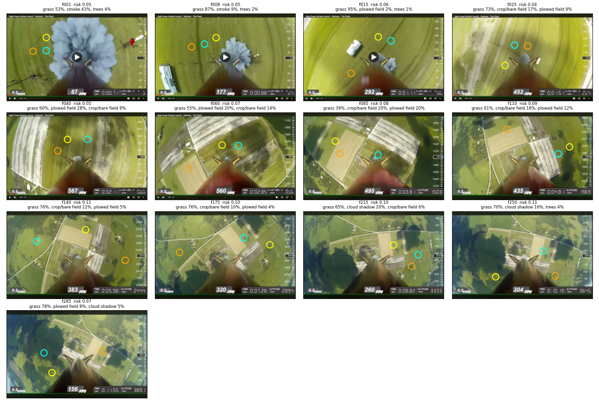

# Rocket Payload – Terrain & Landing-Zone Analysis

We take frames from a rocket's downward-facing camera, label the terrain in each one, and pick the three safest spots to land.

Test footage: the YouTube video **"High Power Rocket Launch – Darkstar – The Flash"**. We analysed 13 frames, from the pad (~3 ft) up to about 3,900 ft.



---

## How it works

Each frame goes through [`src/terrain_model.py`](src/terrain_model.py):

| Step | What it does | How |
|---|---|---|
| 1. Ignore mask | Hides the HUD, the altitude tape and the rocket body/fins. | Built once from the whole video: `data/ignore_mask.npy` (960×600). |
| 2. Superpixels | Splits the visible ground into about 1,200 regions. | SLIC (scikit-image). |
| 3. Terrain class | Gives each region a class: grass, crop/bare field, plowed field, trees, cloud shadow, water or smoke. | Hand-tuned rules on hue, saturation, brightness, texture and blue bias. |
| 4. Thin hazards | Finds roads and small bright structures such as buildings and vehicles. | Sato ridge filter for roads, top-hat blob detection for structures. |
| 5. Object detector | Looks for smoke, buildings, vehicles, people and water by name. Each mask is checked against the pixel colours before it is kept. | YOLOE-11L-seg (`ultralytics`), pretrained, used zero-shot. |
| 6. Landing score | Scores every pixel for risk, averages it over a landing circle and returns the 3 best spots. | See below. |

> **Note:** nothing in this pipeline is trained on our data. Steps 2–4 are hand-written rules, and step 5 uses a pretrained model with text prompts.

### Landing risk

Each class has a base risk (0 = safe, 1 = unsafe):

| grass | crop/bare | plowed | cloud shadow | smoke | trees | road | water | structure |
|---|---|---|---|---|---|---|---|---|
| 0.05 | 0.12 | 0.35 | 0.55 | 0.85 | 0.90 | 0.95 | 1.0 | 1.0 |

On top of the base risk:

- **Hard hazards** (trees, water, roads, structures) raise the risk of nearby pixels too. This extra risk fades over about 30 px (`BUFFER`).
- **The fisheye edge** is penalised because the image there is far away and blurry (`EDGE_PEN`).
- **The landing circle** has a radius of 22 px (`FOOT`). A spot's score is `0.7 × mean + 0.3 × max` of the risk inside the circle. A circle may not overlap the ignore mask.
- **Spots are kept at least 90 px apart**, so the three picks are different places.

**Verdict** for the best spot: `GOOD` if the score is below 0.08, `OK` if it is below 0.15, and `RISKY` otherwise.

---

## Results

The full table is in [`results/summary.csv`](results/summary.csv). Each per-frame image, for example [`results/f085.png`](results/f085.png), has three panels: the original frame, the terrain classes, and a risk heatmap with the top 3 spots (cyan = #1, yellow = #2, orange = #3).

| Frame | Altitude (ft) | Best risk | Verdict | Main terrain |
|---|---|---|---|---|
| f001 | 3 | 0.052 | GOOD | grass 53%, smoke 43% |
| f008 | 24 | 0.051 | GOOD | grass 87%, smoke 9% |
| f015 | 96 | 0.056 | GOOD | grass 95% |
| f025 | 224 | 0.041 | GOOD | grass 73%, crop 17% |
| f040 | 580 | 0.051 | GOOD | grass 60%, plowed 28% |
| f060 | 996 | 0.067 | GOOD | grass 55%, plowed 20% |
| f085 | 1503 | 0.082 | OK | grass 39%, crop 20%, plowed 20%, shadow 14% |
| f110 | 1969 | 0.094 | OK | grass 61%, crop 16% |
| f140 | 2444 | 0.109 | OK | grass 76%, crop 12% |
| f175 | 2894 | 0.103 | OK | grass 76%, crop 10% |
| f215 | 3333 | 0.099 | OK | grass 65%, cloud shadow 20% |
| f250 | 3645 | 0.114 | OK | grass 70%, cloud shadow 16% |
| f285 | 3891 | 0.072 | GOOD | grass 78%, plowed 8% |

**What we see:**

- **Below ~1,000 ft**, almost the whole view is open grass, so every frame is `GOOD`. Near the pad, launch smoke is detected correctly and avoided.
- **Above ~1,500 ft** the risk rises to about 0.10. More roads, farm buildings and tree lines come into view, and their buffers leave fewer large clear areas.
- **Cloud shadows** take up to 20% of the view (f215, f250). They are scored as fairly risky because we can't see what is under them. The ground there is probably fine.

---

## Project layout

```
Rocket_Payload/
├── src/
│   └── terrain_model.py      # the pipeline
├── scripts/
│   └── extract_frames.py     # video -> data/frames/fNNN.jpg
├── data/
│   ├── ignore_mask.npy       # HUD / rocket mask (tracked)
│   ├── frame_index.csv       # frame -> HUD altitude -> original screenshot
│   ├── frames/               # f001..f286.jpg input frames (git-ignored, 17 MB)
│   └── video/                # source video (git-ignored)
├── models/                   # yoloe-11l-seg.pt goes here (git-ignored)
├── results/                  # per-frame PNGs, summary.png, summary.csv
├── .vscode/                  # interpreter, run configs, recommended extensions
├── requirements.txt
└── README.md
```

---

## Setup

Run these in the VS Code terminal (PowerShell):

```powershell
python -m venv .venv
.venv\Scripts\Activate.ps1
pip install -r requirements.txt
```

`ultralytics` also installs PyTorch, which is a large download. If you only need the rule-based part, install `numpy scipy scikit-image pillow matplotlib` and run with `--no-yolo`.

**YOLOE weights:** put `yoloe-11l-seg.pt` in `models/`. `ultralytics` usually downloads it the first time you run, so you can move it there afterwards.

## Running

**1. Get frames.** The 286 frames used for our results are already in `data/frames/` as `f001.jpg` to `f286.jpg`, in flight order. We sorted the original screenshots by reading the HUD altitude with OCR. [`data/frame_index.csv`](data/frame_index.csv) lists each frame's altitude and the screenshot it came from. Consecutive duplicate screenshots are kept, so the frame numbers match `results/`.

To pull fresh frames from the video instead, put the video in `data/video/` and extract them:

```powershell
yt-dlp -f "bv*[ext=mp4]" -o data/video/flight.mp4 <youtube-url>
python scripts/extract_frames.py data/video/flight.mp4 --start 0.7 --end 12
```

**2. Run the model:**

```powershell
python src/terrain_model.py data/frames results            # with YOLOE
python src/terrain_model.py data/frames results --no-yolo  # rules only, fast
```

You can also press **F5** in VS Code and choose one of the run configs in `.vscode/launch.json`.

A rules-only run takes about 7 seconds per frame on a laptop CPU, so all 286 frames take about 35 minutes.

**Outputs** go to `results/`: one `fNNN.png` per frame, plus `summary.csv` and `summary.png`.

---

## Tuning

All the settings are at the top of `src/terrain_model.py`:

| Setting | Meaning |
|---|---|
| `RISK` | Base risk for each class. |
| `HARD` | Which classes get a keep-away buffer. |
| `FOOT` | Landing-circle radius in pixels. Scale it with altitude for a real footprint. |
| `BUFFER` | How far, in pixels, hazard risk spreads. |
| `EDGE_PEN` | How strongly the fisheye edge is penalised. |
| `classify()` | The HSV and texture thresholds for each terrain class. |

## Known limitations and next steps

- **The rules are tuned by eye on this one video.** Different light, season or camera will need new thresholds. A small hand-labelled set and a trained segmenter would make it more robust.
- **Results are in pixels, not metres.** Converting a spot to a ground position needs altitude (from the HUD or telemetry), the camera's field of view, attitude, and fisheye un-distortion.
- **There is no ground truth**, so we can't measure accuracy yet. Labelling a few frames would let us report per-class IoU.
- **Early frames include YouTube player graphics** (play button, player bar). Frames taken straight from the downloaded video won't have them.
- **The ignore mask is fixed.** If the camera moves or the HUD changes, it needs to be rebuilt.
